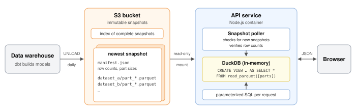

If you have spent most of your career building OLTP applications like I have, you have a well-worn model for how an app gets its data. There is a database server, rows go in and out, and when something gets slow you add an index. Files in S3 are for exports, and analytical data lives in a warehouse you query from a notebook, not from a page someone is waiting on.

This post is for you if that sounds familiar and you haven't tried a columnar format like Parquet. We recently shipped an internal, read-only analytics app where the data doesn't live in a database server at all. It lives in Parquet files in S3, and every API request is a DuckDB query against those files.

A quick primer
--------------

Parquet is a columnar file format. Instead of storing each row's values together, it stores each column's values together in compressed chunks, with the schema and min/max statistics in the file. A query that needs three columns out of thirty only reads those three, and a filter can skip chunks whose statistics rule them out. You don't update a Parquet file, you write a new one - which sounds like a limitation if you come from OLTP, but for read-only data it means nothing changes underneath you.

DuckDB is an embedded analytical database, think SQLite built for analytics. It runs inside your process, so there is no server to operate, and it can query Parquet files directly:

```sql
SELECT group_id,
       count(*) AS observations,
       median(value) AS median_value
FROM read_parquet('snapshot/observations/*.parquet')
WHERE is_valid
GROUP BY group_id;
```

The part I like is that DuckDB lets you run real SQL against data that isn't in a database at all. No tables to create, nothing to load.

Why not just query the warehouse?
---------------------------------

That was the obvious option, and during planning we tried hard to make it work. We built dbt models so every request was a single-table read with filtering, ordering and a limit, tried different distribution and sort keys, and precomputed percentiles during the build. That prep helped both options.

Then we benchmarked ten query cases against Redshift and against the same data as local Parquet in DuckDB, with matching SQL and verified results. That was 160 measured requests per query per engine, warmups excluded, result caching off. To be generous to Redshift, we subtracted 145 ms from every measurement for connection overhead, slightly more than the largest overhead we measured with a separate latency probe.

Redshift could execute some of these queries in low milliseconds, but across the ten cases the full-request p95 was 460 to 1,795 ms. Local Parquet with DuckDB was 7 to 36 ms, roughly 33 to 125 times faster at p95 depending on the query.

To be fair, that doesn't establish Redshift's limit. Our cluster is shared, every run overlapped dbt refresh work, and a bigger cluster would probably help (at a cost). But that variability is kind of the point. Exploring data means changing a filter, looking, and changing it again, and we didn't want that loop to depend on what else the warehouse was doing.

Why not just load it into Postgres?
-----------------------------------

If you come from OLTP this is probably your first question, and we did consider it. But it means another database to run, a loading process and an indexing strategy, all for data the app never writes and that gets rebuilt every day anyway.

How it works
------------

To serve plain files in production, you need two things a database normally gives you for free: atomic updates and schema safety. A request should never read a half-written export, and an upstream column change shouldn't quietly break your queries overnight.



The pipeline is pretty boring, which I mean as a compliment. After the warehouse refreshes, dbt builds the models and uses Redshift `UNLOAD` to write Parquet to a new, unique prefix in S3, one directory of part files per dataset. A manifest records each dataset's row count and part sizes, and the snapshot only goes into an index once it is complete. It is never modified after that.

We mount the S3 bucket into the API container as a read-only file system, so to DuckDB it is just a directory of files. You don't have to do it that way - DuckDB can also read Parquet straight out of S3, and with DuckDB 2.0 that is going to be faster than you think. The service polls for new snapshots, and opening one is just creating views over the files in a fresh, in-memory DuckDB instance:

```sql
CREATE VIEW my_dataset AS
SELECT * FROM read_parquet([
    '/data/parquet/<snapshot>/my_dataset/part_0000_part_00.parquet',
    '/data/parquet/<snapshot>/my_dataset/part_0001_part_00.parquet'
]);
```

Nothing gets loaded into DuckDB, it's all just views. Before a snapshot serves anything, we count every view and compare the counts to the manifest. That forces DuckDB to actually open every file, so a partially synced or corrupt export never gets adopted. If a new snapshot fails, the old one keeps serving and we try again on the next poll. Once a new one passes, new requests go to it, in-flight queries finish on the snapshot they started on, and the old instance closes once they drain, all without a redeploy.

For schema safety, the schema version is a hash of the exported schema, not a number someone has to remember to bump, and each API build knows which hash it supports. A daily refresh keeps the same hash and gets picked up automatically. A structural change gets a new hash, and the API keeps serving the newest snapshot it understands until the code that reads the new shape ships.

The queries aren't toys either. They join across views, use CTEs, window functions, continuous percentiles and histograms, and paginate with `LIMIT ? OFFSET ?`. Our heaviest request fires off about two dozen SQL queries at once and combines the results.

How fast is it in production?
------------------------------

We measured production from one signed-in browser session with normal caching, loading every page type repeatedly: 192 full page loads and 304 data API calls, all successful. These are end-to-end numbers covering network, API, DuckDB and rendering together, so they don't isolate DuckDB's share.

The snapshot behind these pages is six Parquet datasets totaling 371,685 rows, ranging from about 6,400 to 177,000 rows each.

Our lightest page makes a single data call that returns about half a KiB of JSON. Others make as many as four calls per load. The heaviest page makes two calls that bring back 20 separate datasets and 2.95 MiB of JSON. Individual datasets range from one row to just over 1,000 and from one to 35 columns. Byte sizes are measured in the browser.

Across all 192 page loads, the median page reached meaningful content in 508 ms. Two thirds of loads got there in under 600 ms and about three quarters in under a second. The 95th percentile was 2.42 s, and 43 of the 44 loads that took longer than a second came from the two pages that pull the most data.

Across all 304 data API calls, timed from request start to the last byte, the median was 339 ms and the fastest was 164 ms. About 70% finished in under 500 ms and over 90% in under a second. The 95th percentile was 2.03 s, and every call over a second came from our single heaviest page.

For an app with no database server, I am pretty happy with that, and for most pages the page load feels instantaneous.

Things to keep in mind
----------------------

This isn't free. You own the export pipeline, and your data is only as fresh as your last snapshot. Ours refreshes daily, which is fine for this app, but if you need to read your own writes you still want an OLTP database.

Compressed file size also doesn't tell you how much memory a query will use. We set DuckDB's `memory_limit` well inside what the container can spare, so a greedy query fails on its own instead of getting the container killed along with every request in flight.

Conclusion
----------

The main takeaway I hope you get from this is that a file format can be a perfectly good production backend for read-only data. You don't need a database server, an index strategy or a loading process. You need immutable files, a manifest you can verify, and an engine that can query them where they sit.

It also changed the first question I ask on a project like this. Instead of "which database?", it is "how much of the work can we do before someone opens the page, and how fresh does the answer need to be?" If a daily snapshot is fresh enough, you can do a lot with a directory of Parquet files and the SQL you already know. I really recommend putting DuckDB in front of a few files and seeing what it can do.
